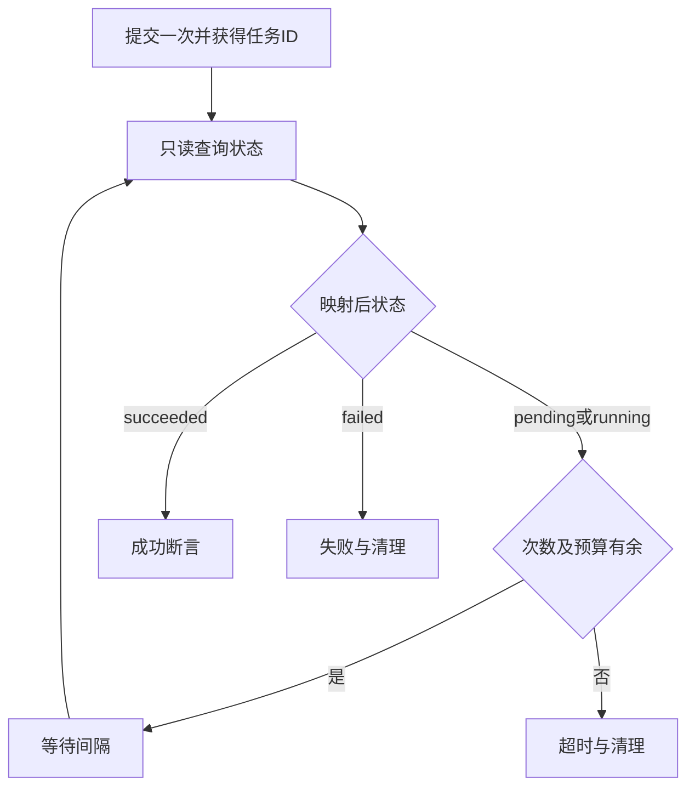

# 异步任务：等待状态终态

任务提交一次，之后有界查询状态，避免反复创建同一业务。

## 提交与轮询的区别 {#flow}

状态查询步骤选等待异步终态，业务用途为已确认query。写入式“创建任务”不参与轮询。

## 示例与预算 {#example}

响应 `{"code":200,"data":{"state":"processing"}}`，实际枚举为processing/done/error时，状态字段data.state，映射 `{"processing":"running","done":"succeeded","error":"failed"}`，间隔2秒、总预算60秒、最多30次。

间隔是两次查询之间多久；次数是查询上限；预算包含查询、等待、网络和认证重试。任一终止条件先达到即停止，不用次数乘间隔猜准确耗时。未知状态明确报错，不按成功处理。

## 状态字段 {#state-selector}

取真正代表任务状态的响应路径，不是业务成功码。

**在哪里使用：** 等待步骤 → 状态字段。

**填写或阅读示例：** `data.state`对应processing。

**应该看到什么：** 交给状态映射判断是否继续。

**常见错误：** 填目标状态succeeded或把code=200当任务结束。

## 状态映射 JSON {#state-map}

原始枚举映射pending/running/succeeded/failed，需显式包含成功终态。

**在哪里使用：** 等待步骤 → 状态映射JSON。

**填写或阅读示例：** `{"processing":"running","done":"succeeded","error":"failed"}`。

**应该看到什么：** done结束，error失败，未知枚举报错。

**常见错误：** 漏成功状态或大小写不符。

## 轮询间隔 {#poll-interval}

相邻状态查询间等待时长，约束查询频率。

**在哪里使用：** 等待步骤 → 间隔秒。

**填写或阅读示例：** 接口允许时2秒；高成本接口按契约增加。

**应该看到什么：** 有界间隔继续查询。

**常见错误：** 当毫秒使用或设极小频繁请求。

## 总等待预算 {#poll-deadline}

包括查询等待和相关重试，不是单次HTTP超时。

**在哪里使用：** 等待步骤 → 总等待预算秒。

**填写或阅读示例：** 任务通常40秒，按确认上限设60。

**应该看到什么：** 未到次数上限也会因预算耗尽停止。

**常见错误：** 为了不报错设无限大，长期占槽。

## 最大查询次数 {#poll-attempts}

限制总查询次数，与预算共同生效。

**在哪里使用：** 等待步骤 → 最大次数。

**填写或阅读示例：** 间隔2秒最多30次预算60秒。

**应该看到什么：** 到次数还无成功终态会超时。

**常见错误：** 忽略请求耗时而以次数乘间隔当精准期限。

## 安全查询网络重试 {#network-retries}

0—3次，只处理确认query的瞬时网络错误，401刷新重放另计。

**在哪里使用：** 等待步骤 → 安全查询网络重试。

**填写或阅读示例：** 默认0，确认可有限重发的状态查询可设1。

**应该看到什么：** 断言失败不会因该项自动重跑。

**常见错误：** 误以为允许重发写操作或重试业务失败。

## 高级等待策略 {#wait-policy}

可补退避、最大间隔、轨迹上限及成功/失败断言。可视化同名字段以表单值为准。

**在哪里使用：** 等待步骤 → 高级策略JSON。

**填写或阅读示例：** `{"backoff":1.5,"max_interval_seconds":10,"trace_limit":50}`，常规状态映射和预算仍在表单配置。

**应该看到什么：** 间隔按退避增长但不超上限，记录有界轨迹。

**常见错误：** 填未知字段，或只加JSON不填写状态契约。
