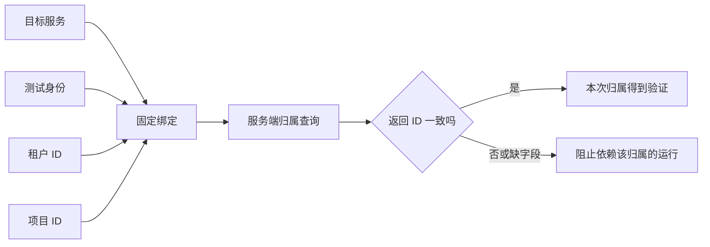

# 租户、项目与归属回读

同一个账号可能在多个空间有不同数据和权限，绑定防止测试跑错范围。

## 三个 ID 各是什么 {#relation}

租户可理解为一家组织，项目是组织内的业务空间，用户是登录的人。项目绑定把目标、身份、租户 ID 和项目 ID 固定在一起。业务系统不一定叫这些名字，请对照真实字段，不把页面显示名称当 ID。

## 先核对返回，再填写路径 {#readback}

若真实归属响应为 `{"data":{"tenantId":"tenant-test","deptId":"project-test"}}`，租户回读路径为 `data.tenantId`，项目回读路径为 `data.deptId`。这些是取值路径；绑定字段才填实际租户、项目 ID。

请求头写了某项目，只证明发送了该文本；回读到匹配归属才是相应证据。普通 `{"code":200}` 健康检查没有租户/项目信息，不能证明上下文正确。

## 租户 / 项目绑定 {#binding}

把一个身份限制在已确认的目标与业务空间，后续预检和运行核对同一组关系。

**在哪里使用：** 环境管理 → 租户/项目绑定；场景设置 → 租户/项目绑定。

**填写或阅读示例：** 目标 customer-test、身份 test-user、租户 tenant-test、项目 project-test；ID 全部替换为已确认值。

**应该看到什么：** 保存的绑定可供该目标/身份组合选择。

**常见错误：** 从另一账号复制项目 ID，以为仅换 ID 就获得权限。

## 租户 ID {#tenant-id}

组织在业务系统中的稳定标识，不是显示名。

**在哪里使用：** 项目绑定及专属资源池 → 租户 ID。

**填写或阅读示例：** 填接口和资源清单确认的 `tenant-test`（示例），不要填“测试公司”名称。

**应该看到什么：** 归属回读取到的租户与绑定相同。

**常见错误：** 拿环境 ID 代替租户 ID，或忽略账号当前实际租户。

## 项目 ID {#project-id}

测试数据所在的已确认业务空间，必须与身份、目标及租户相容。

**在哪里使用：** 项目绑定及资源池 → 项目 ID。

**填写或阅读示例：** 填专用测试项目的真实 ID；将显示名称“项目A”和真实 ID 分开记录。

**应该看到什么：** 运行固定到该项目并用回读证据校验。

**常见错误：** 项目改了但沿用之前预检通过的印象，未重新验证新上下文。

## 归属查询路径 {#scope-path}

提供当前账号真实租户/项目信息的已确认只读接口。

**在哪里使用：** 目标系统 → 归属查询路径。

**填写或阅读示例：** 若契约有 `/api/user/context`，填相对路径并确认它确实返回实际归属。

**应该看到什么：** 真实预检调用该查询，并将字段交给后续路径解析。

**常见错误：** 把 ping 接口放进来，只验证 code 而没有归属字段。

## 租户回读字段 {#tenant-path}

从归属查询响应里取租户 ID 的路径。

**在哪里使用：** 目标系统 → 租户回读字段。

**填写或阅读示例：** 响应位于 data.tenantId 时填 `data.tenantId`。

**应该看到什么：** 取值与绑定 tenant_id 一致才构成匹配证据。

**常见错误：** 填固定的 tenant-test 值，或大小写与实际字段不同。

## 项目回读字段 {#project-path}

从归属查询响应里取项目 ID 的路径，名称由真实接口决定。

**在哪里使用：** 目标系统 → 项目回读字段。

**填写或阅读示例：** 响应位于 data.deptId 时填 `data.deptId`；返回 projectId 则用实际路径。

**应该看到什么：** 取值与当前绑定 project_id 核对，不沿用其他项目结果。

**常见错误：** 把 tenantId 同时填到项目路径，造成表面上都有值却语义错误。
