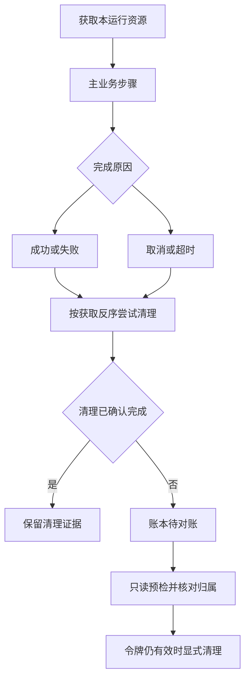

# 取消、超时后怎么处理资源

主流程结束不代表数据已清理，必须查看本运行的资源账本。

## 独立的清理分支 {#flow}

清理失败不覆盖原业务失败，原业务通过也不等于清理通过。创建结果不明、没有对象ID时归属不确定，不按名称批量搜索删除。租约到期也不证明业务恢复，先按账本处理。

## 资源 / 清理预检 {#cleanup-preflight}

只读列出本run拥有资源和可清理动作，返回绑定当前资源状态的令牌。

**在哪里使用：** 执行结果 → 资源/清理预检。

**填写或阅读示例：** 对已结束且有待办资源的run预检，核对目标项目和对象ID。

**应该看到什么：** 预检不删除；活跃或归属未知可能不可清理。

**常见错误：** 把任意对象ID塞入，希望平台代删。

## 执行本次预检清理 {#cleanup}

按刚核对的清单删除本次创建对象或恢复借用对象，状态变更后令牌失效。

**在哪里使用：** 本次资源预检后 → 执行清理。

**填写或阅读示例：** 资源无变化时提交本次preflight_token；失效则重新预检。

**应该看到什么：** 记录真实清理结果，原业务失败保持。

**常见错误：** 复用过期令牌，或以为清理成功能改业务结论。
