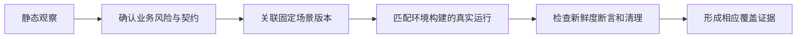

# 覆盖账本：风险、契约与真实证据

代码里出现一条接口调用，只是观察线索，不等于该风险已真实验证。

## 从观察到覆盖 {#flow}

扩展工具 → 覆盖与研究账本可导入已有研究资料、筛目标端/路径、查看来源位置和日期，再记录依据并关联场景。导入不发送业务请求。未知请求字段不是“不需要参数”。

## 建立一条关联 {#link-example}

选观察项 → 填清晰风险 → 选择真实契约状态 → 写依据/确认人/日期 → 关联发布场景数组 → 保存。之后用同构建、环境、版本的有效真实运行形成证据。关联本身不会自动把覆盖变绿。

## 业务风险覆盖账本 {#coverage}

追踪观察、已确认风险和固定版本证据，含真实验证范围。

**在哪里使用：** 扩展工具 → 覆盖账本。

**填写或阅读示例：** 查客户筛选风险，关联对应已发布场景，再看近期live证据。

**应该看到什么：** 能区别静态观察与已验证风险。

**常见错误：** 把接口条数或导入成功当覆盖率。

## 业务风险编号 {#risk-id}

按已确认目录关联：核心API S01—S16，Web/App对应W/A。

**在哪里使用：** 覆盖/旅程 → 业务风险编号。

**填写或阅读示例：** 只有场景实际验证该风险时关联对应编号。

**应该看到什么：** 匹配版本环境构建的证据才计入。

**常见错误：** 按名称猜编号，或一个query smoke声称覆盖所有风险。

## 发布必需风险 {#required}

标记发布必须有证据的风险；核心S风险自动必需。

**在哪里使用：** 覆盖 → 发布必需。

**填写或阅读示例：** 关键业务确认后设required_for_release。

**应该看到什么：** strict缺有效覆盖会明确阻塞。

**常见错误：** 取消标记试图抹除核心要求。

## 契约状态 {#contract-status}

unconfirmed未核实，confirmed有依据，blocked缺资源或有障碍。

**在哪里使用：** 覆盖 → 契约状态与依据。

**填写或阅读示例：** 写接口资料版本、确认人、日期及影响范围。

**应该看到什么：** 可追溯为何认为契约成立。

**常见错误：** 只从静态表达式猜字段即标confirmed。

## 固定场景引用 JSON {#references}

固定场景ID/version数组，仅建立追踪关系。

**在哪里使用：** 覆盖 → 场景引用JSON。

**填写或阅读示例：** `[{"scenario_id":"<实际场景ID>","version":1}]`。

**应该看到什么：** 引用对应真实发布定义，运行还需有效证据。

**常见错误：** 填草稿r号，或关联后声称已经通过。
