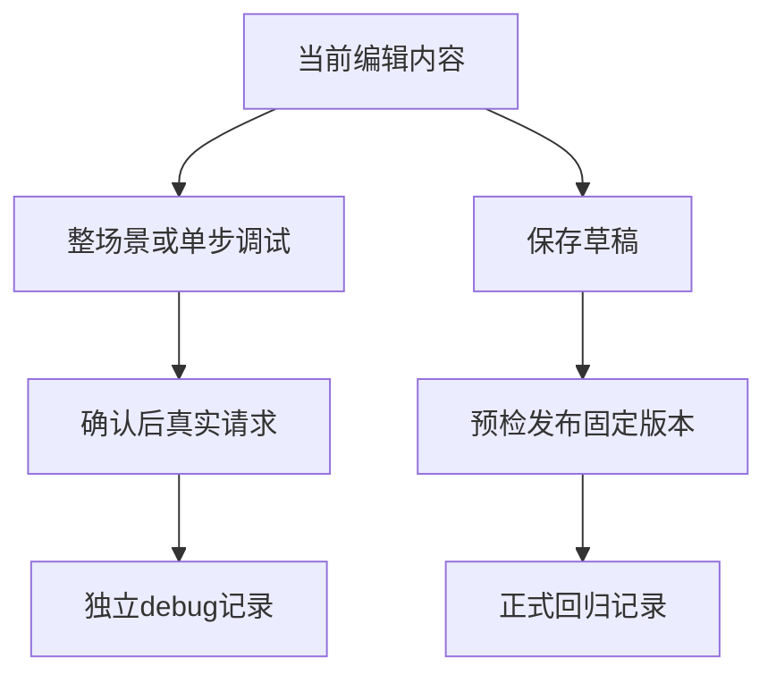

# 调试当前草稿与单步

> 当前界面入口：在“编辑与调试”中选择步骤，方法与 URL 旁的“仅调试此步骤”调试单步，工具栏“调试当前整场景”执行整场景。结果在编辑区下方，按响应、请求、断言、变量提取和完整证据切换；结果来自上次确认的快照，继续编辑不会自动更新它。

调试执行眼前编辑，不自动保存或发布，也不是离线模拟。

## 两条路径 {#flow}



修改未保存URL后调试使用新值，正式运行仍使用所选发布快照。调试不计入正式统计、覆盖或发布证据；构建未知可以调试，但不能冒充完整发布依据。

## 单步不自动补跑前步 {#single-step}

详情读outputs.list_customers.id时，单步不自动请求列表，需显式补输入：

```json
{"list_customers":{"id":"customer-001"}}
```

外层是步骤ID，不再包outputs。输入仅用于本次单步，必须是已确认测试对象。

数据库核验依赖身份/项目回读，拒绝单步；有fixtures、清理步骤或带配套清理约束的write步骤也需整场景。不要删保护字段绕过限制。

## 调试公开参数 {#debug-parameters}

覆盖当前草稿默认值，不保存回草稿；键须在schema声明。

**在哪里使用：** 调试 → 本次公开参数JSON。

**填写或阅读示例：** schema有page，本次填 `{"page":2}`；无覆盖填 `{}`。

**应该看到什么：** 本次用2，默认仍1。

**常见错误：** 填套件按场景分组格式或未声明键。

## 前置 outputs 输入 {#debug-inputs}

显式补给所需前置输出，不自动执行生产步骤。

**在哪里使用：** 单步调试 → 前置outputs输入。

**填写或阅读示例：** `{"list_customers":{"id":"customer-001"}}`。

**应该看到什么：** 引用成立才执行，输入不留给下次运行。

**常见错误：** 再次包outputs层，或用未知归属ID。

## 调试当前整场景 {#debug-scenario}

执行当前编辑和依赖，按声明处理资源/清理。

**在哪里使用：** 编辑顶部 → 调试当前整场景。

**填写或阅读示例：** 核对目标身份后确认范围并真实调试。

**应该看到什么：** 独立debug记录，草稿与版本不被自动保存。

**常见错误：** 以为调试是mock或绝不会改数据。

## 仅调试此步骤 {#debug-step}

只执行选中步骤，前置须显式补输入；受资源和数据库限制。

**在哪里使用：** 步骤 → 仅调试此步骤。

**填写或阅读示例：** 独立query可单步，缺输出时按面板填写inputs。

**应该看到什么：** 缺值明确报错，不用上次数据兜底。

**常见错误：** 把单步通过当整场景通过或删除清理约束强行调试。
