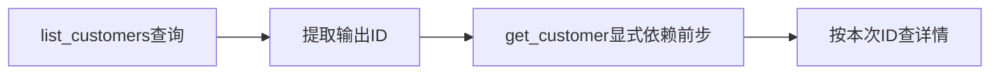

# 依赖：为什么前一步失败后不能继续

后一步需要前一步的输出，必须把依赖写清楚。

## 数据依赖不是屏幕排序 {#chain}

读取 `outputs.list_customers.id` 时，后步必须依赖list_customers，生产步骤必须声明这个输出。不能仅把两步拖在一起。

教学只有一个合成客户，可用第0项解释路径。真实列表不稳定时不要任意取第一条；用明确筛选和对象归属断言，保证操作的是已确认测试数据。

## 前置步骤依赖 {#dependencies}

填前置稳定ID，可多个；必须向前，禁止循环和后向引用。

**在哪里使用：** 请求选项 → 依赖。

**填写或阅读示例：** 详情步骤填 `list_customers` 并引用其outputs。

**应该看到什么：** 预检核对生产者和输出，前置失败时后续不能冒充通过。

**常见错误：** 填中文名称、后面步骤ID，改ID后未改依赖。
