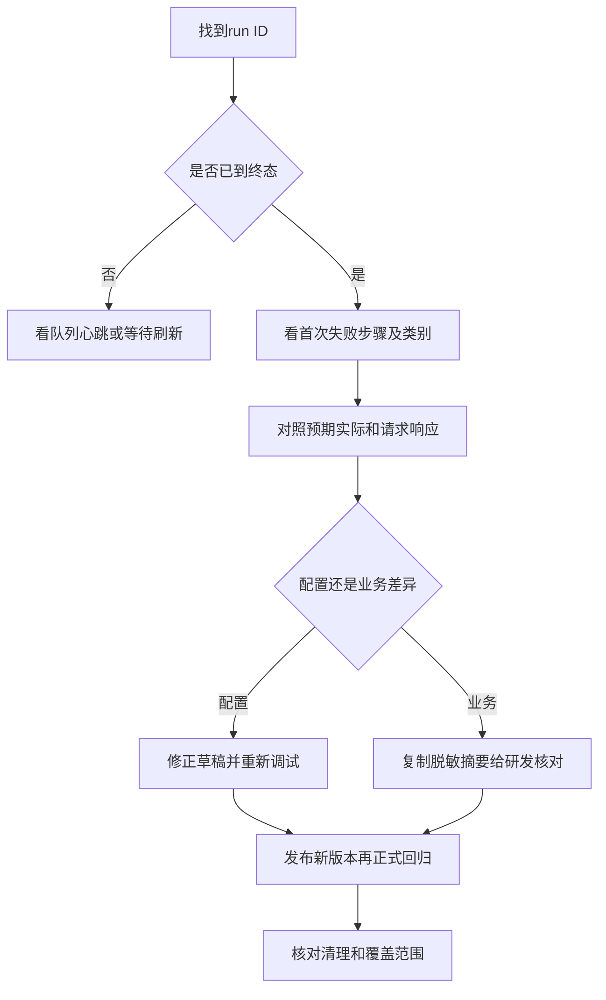

# 执行结果：状态、首错与复跑

先看首个失败步骤，再看预期实际和脱敏请求响应，避免被后续阻塞淹没。

## 排查链路 {#flow}

先记录run ID、环境、目标、构建和资产版本。`failed`多为断言不符，`error`可能是配置/执行异常，`blocked`表示前置条件缺少，不要都归因于被测业务错误。

## 一个差异怎么读 {#difference}

断言“详情ID一致”预期customer-001、实际customer-002，先核对实际请求URL、提取输出和项目范围。字段为null、缺字段、脱敏占位是不同情况。不要为了让它变绿直接改期望成当前错误值。

## 复跑先核对影响 {#retry}

快速复跑和失败场景复跑都会创建新尝试，可能真实改数据。原失败保留；失败部分从准备阶段重新建立必要数据，不从半途继续。复跑通过不覆盖原记录，也不等于完整套件通过。

## 运行状态 {#run-status}

queued排队，running执行中，succeeded当前断言通过；failed断言失败，error执行错误，blocked前提缺少，timed_out超时，cancelled取消，skipped跳过，interrupted中断。

**在哪里使用：** 执行结果 → 状态。

**填写或阅读示例：** 新提交先queued，再看终态与debug标识。

**应该看到什么：** 清楚记录处在哪个阶段及结论范围。

**常见错误：** 把排队当成功，或将blocked当业务越权已验证。

## 错误类型 {#error-category}

定位主因：config配置、authentication认证、context归属、data数据、network网络、assertion断言、executor执行器、external_service外部服务、device设备、unknown未分类。

**在哪里使用：** 运行筛选/首错 → 错误类型。

**填写或阅读示例：** 401先看authentication，字段差异看assertion，但仍读原证据。

**应该看到什么：** 缩小排查范围，不修改结果。

**常见错误：** 只按分类下结论而不看请求/响应。

## 快速复跑 {#rerun}

以原运行快照新建尝试，保留原记录，仍可能真实请求。

**在哪里使用：** 运行列表 → 快速复跑。

**填写或阅读示例：** 确认原目标身份和数据可再执行后复跑。

**应该看到什么：** 生成新的run ID与原尝试关联。

**常见错误：** 认为覆盖原失败，或已失效对象可不核对。

## 仅复跑失败场景 {#failed-rerun}

失败范围创建关联新运行，从准备阶段重建所需数据。

**在哪里使用：** 运行诊断 → 仅复跑失败场景。

**填写或阅读示例：** 失败场景修复依据明确后复跑，再看新run终态。

**应该看到什么：** 只得到局部验证，不代表完整套件重新通过。

**常见错误：** 把它理解为续执行半个请求。

## 请求取消 {#cancel}

请求停止后续步骤并尝试清理，不立即强杀，已发送请求不能保证撤回。

**在哪里使用：** 活动运行 → 请求取消。

**填写或阅读示例：** 误提交时请求取消，等待终态并核对资源。

**应该看到什么：** cancelled或其他终态有记录，清理另看。

**常见错误：** 反复取消以为业务写入已回滚。

## 运行快照 {#snapshot}

保存本次环境、目标、身份、版本和公开参数，后改配置不改历史。

**在哪里使用：** 运行详情 → 运行快照。

**填写或阅读示例：** 查这次究竟v1还是v2，参数page取什么。

**应该看到什么：** 可以复盘当时执行范围。

**常见错误：** 把脱敏占位当真实null或把最新草稿当历史定义。

## 执行证据完整性 {#evidence}

结合实际步骤、断言和资源清理判断单次证据完整性，不等于发布许可。

**在哪里使用：** 诊断 → 执行证据完整性。

**填写或阅读示例：** 成功run仍检查cleanup与build/版本/覆盖。

**应该看到什么：** 知道可审阅证据是否齐备。

**常见错误：** 单次完整直接宣称所有业务可发布。

## 运行对比 {#compare}

只读对比版本、环境及首次失败，不重新执行。

**在哪里使用：** 诊断 → 对比run ID。

**填写或阅读示例：** 输入另一实际run ID，先确认是否可比。

**应该看到什么：** 保留双方差异和原始结果。

**常见错误：** 输入场景名称或拿不同环境结果互相覆盖。

## 原始执行数据 {#raw-evidence}

实际记录的步骤、计数及结果，用于核对摘要，敏感值已脱敏。

**在哪里使用：** 运行详情 → 原始执行数据。

**填写或阅读示例：** 摘要有疑问时展开对应步骤与attempt记录。

**应该看到什么：** 能追到断言来源及尝试过程。

**常见错误：** 把脱敏文本当可重用秘密，或把历史未知解释成已通过。
