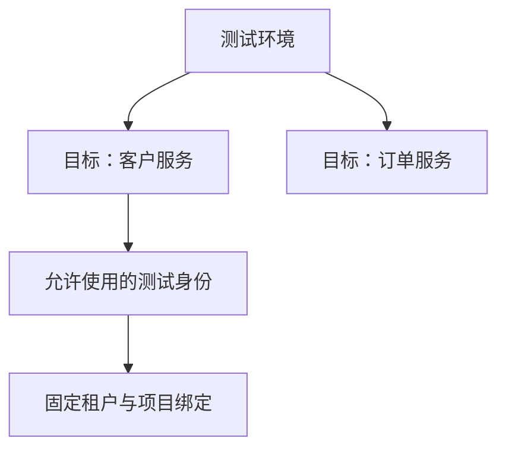

# 环境与公开变量

> 当前界面入口：环境管理顶部提供“环境”“目标系统”“身份”“租户 / 项目绑定”四个入口。每类配置通过目录选择，目录支持名称检索，选择对象后编辑；切换会丢失当前配置时需先确认。

环境用于组织测试配置；实际请求地址仍要核对目标系统。

## 环境与目标别混为一谈 {#relationship}

一个环境可以有多个目标。环境像“测试园区”，目标像园区里的具体服务门牌。只修改环境显示名称，不会把已发布场景切换到另一套服务。

## 创建环境与变量 {#create}

进入“环境管理”，新增环境，填写名称与基础地址，按当前配置情况标记状态并保存。公开变量应保留真实 JSON 类型，如数字页大小 20、布尔开关 true，不能全部写成字符串。

变量不是凭证存放处。账号密码和 Token 不放这里；身份使用服务端秘密引用。已有默认目标可能是迁移时的地址快照，修改环境地址后仍需单独核对目标，不能假定自动同步。

## 保存发生冲突 {#revision-conflict}

环境修改需要当前修订号。若提示 409/版本已变化，先保留本次修改意图、刷新查看最新配置，再决定如何修改，不连续保存覆盖他人的版本。查看[修订号](/manual/scenario#configuration-revision)。

## 环境 {#environment}

环境标识把配置和运行归到同一执行空间，便于隔离测试与筛选结果。

**在哪里使用：** 目标配置或运行环境选择。

**填写或阅读示例：** 选择已保存的“测试环境”，其 ID 例如 `env-test`，不是临时输入一个标签。

**应该看到什么：** 目标所属环境与运行显式选择保持一致，运行快照会记录该环境。

**常见错误：** 把业务 API 的“测试/正式”仅当成名称，实际目标地址仍指向另一环境。

## 基础地址 {#base-url}

基础地址是服务根地址，不是具体业务接口。步骤路径在该地址上解析，目标的地址决定实际去向。

**在哪里使用：** 环境管理 → Base URL；目标系统 → 基础地址。

**填写或阅读示例：** `https://api.example.test`，步骤再写 `{{host}}/api/customers`。此为占位域名，执行前换真实测试地址。

**应该看到什么：** 实际请求落到所选目标内的接口，不重复拼接路径。

**常见错误：** 在地址里附带账号密码、`?page=1`、`#片段`，或把接口路径重复填写两次。

## 环境状态 {#environment-status}

“待配置/可用”等是配置目录状态，表示维护者如何标记此环境，不是本次网络和权限测试结论。

**在哪里使用：** 环境列表的状态及编辑表单。

**填写或阅读示例：** 信息未齐标记待配置；补齐后可标记可用，并另外做目标预检。

**应该看到什么：** 列表状态改变，但不会因保存而立即发起登录或执行场景。

**常见错误：** 看到“可用”就认为账号、项目权限和所有接口均已验证。
