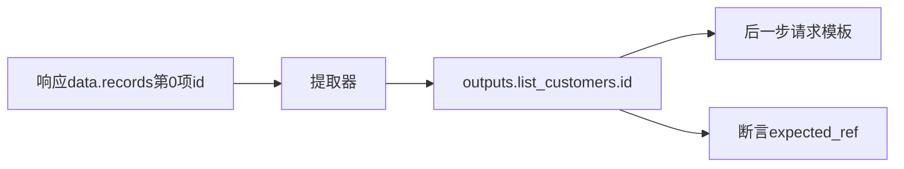

# 变量提取：把响应交给后一步

> 当前界面入口：在“编辑与调试”中选择步骤，再打开“变量提取”标签页；结构化提取规则直接显示，高级提取 JSON 保留独立入口。

提取是把本次响应中的某个值保存给当前场景的后续步骤。

## 从响应提取ID {#example}

假设列表响应 `{"code":200,"data":{"records":[{"id":"customer-001"}]}}`，变量提取添加：

```json
[{"name":"客户ID","source":"response_body","selector":"data.records.0.id","target":"outputs.list_customers.id","required":true}]
```

名称给人看，selector从哪里取，target存到哪里。后步依赖list_customers，URL再写 `{{host}}/api/customers/{{outputs.list_customers.id}}`。



输出只可写 `outputs.<本步骤ID>.*`，不能改params、身份或其他步骤输出。每次运行重新产生，不沿用上次残留值。

## 变量提取 {#extractors}

按来源路径取值，再写本步输出；required=true时null或缺值会报错。

**在哪里使用：** 步骤 → 变量提取/高级提取JSON。

**填写或阅读示例：** selector=`data.records.0.id`，target=`outputs.list_customers.id`。

**应该看到什么：** 显式依赖的后步能取到本次customer-001。

**常见错误：** target漏outputs或写错步骤ID；列表为空仍取第0项。
