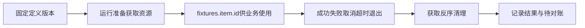

# 测试资源fixture：准备与退出清理

fixture把获取、使用和清理绑定起来，避免重复测试污染环境。

## 定义和场景引用是两层 {#declaration}

扩展工具 → 测试资源与清理配置中先保存不可变定义；场景高级元数据引用定义ID与版本：

```json
{"fixtures":[{"name":"item","definition_id":"<已保存定义ID>","version":1,"depends_on":[]}]}
```

name是本场景引用名，步骤用 `{{fixtures.item.id}}`；创建名可用 `{{runtime.test_prefix}}` 区分运行。fixture依赖必须向前；同名不能重复。



发布和预览不创建资源。主流程退出仍尝试清理，清理失败不掩盖原断言。详情见[清理](/manual/cleanup#flow)。

## 创建型请求示例 {#request-shape}

这是RequestSpec形状，教学接口需换成已确认创建/删除契约：

```json
{"method":"POST","url":"{{host}}/api/test-items","body_type":"json","body":{"name":"{{runtime.test_prefix}}"}}
```

默认从创建响应 `data.id` 取对象ID。删除请求可写 `{"method":"DELETE","url":"{{host}}/api/test-items/{{fixtures.item.id}}","body_type":"none"}`，这里item必须与声明名一致。创建结果不明或缺ID时不会靠名字猜测删除。

## 测试资源 fixture {#fixture}

版本化的资源准备/清理协议，不是普通参数。

**在哪里使用：** 扩展工具 → 测试资源与清理配置 → 新增定义版本；场景元数据fixtures。

**填写或阅读示例：** 先保存定义，声明name=item和definition_id/version，步骤引用fixtures.item.id。

**应该看到什么：** 每次运行有自己的资源账本和退出处理。

**常见错误：** 只填fixtures引用却没有定义，或依赖旧run遗留资源。

## 资源获取策略 {#strategy}

create创建独立对象后删除；lease借专属池并按契约恢复；read_only只读精确对象。

**在哪里使用：** fixture → 策略。

**填写或阅读示例：** 临时订单选create；可恢复测试对象lease；固定只读样本read_only。

**应该看到什么：** 各策略要求的获取/恢复/对象条件在校验中体现。

**常见错误：** read_only对象仍配置写步骤，或lease未准备恢复依据。

## 创建请求定义 {#acquire}

准备阶段的已确认创建请求，create还必须提供释放请求。

**在哪里使用：** fixture → 创建请求定义。

**填写或阅读示例：** 本篇POST RequestSpec，响应真实包含data.id。

**应该看到什么：** 保存定义后，运行才会创建并记录对象ID。

**常见错误：** 把完整场景JSON粘进请求框，或创建结果未知仍猜ID删除。

## 原值查询定义 {#resource-snapshot}

借用前读取精确对象原值，保存到fixtures.item.original供恢复。

**在哪里使用：** fixture → 原值查询定义。

**填写或阅读示例：** GET `{{host}}/api/test-items/{{fixtures.item.id}}`，body_type=none，按真实响应使用original路径。

**应该看到什么：** 取得本次借用前快照。

**常见错误：** 固定默认值当原值，或查询未限定对象。

## 删除 / 恢复定义 {#release}

create删除本运行创建对象，lease按已确认协议恢复原值；都必须有所有权依据。

**在哪里使用：** fixture → 删除/恢复定义。

**填写或阅读示例：** 创建型按本篇精确DELETE；借用型将真实original字段映射回恢复body。

**应该看到什么：** 清理记录返回执行证据，不批量模糊删除。

**常见错误：** 按前缀删整批或把脱敏占位当恢复秘密。

## 借用后恢复 {#restore}

借用可能改数据时先保存原值，退出按协议恢复，不只改池状态。

**在哪里使用：** fixture → 借用后恢复。

**填写或阅读示例：** lease启用restore_required并提供snapshot_request/release_request。

**应该看到什么：** 原值和恢复证据明确，归还不能掩盖业务残留。

**常见错误：** 关闭恢复来绕过缺失契约。
