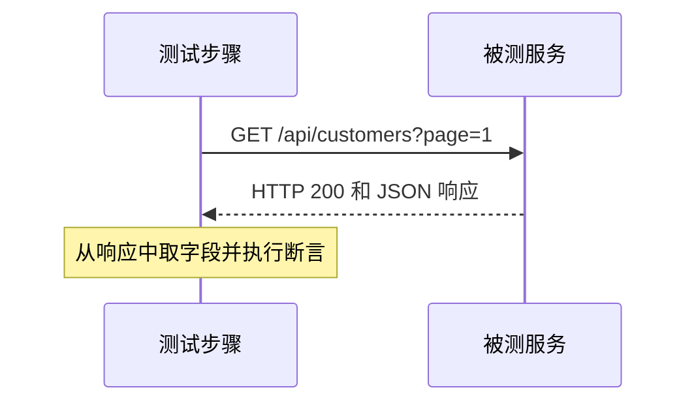

# HTTP：请求与响应是什么

把调用接口看成向服务提出一个明确问题，并检查它给出的回答。

## 一次请求与响应 {#request-response}

HTTP 是客户端和服务通信的一种规则。请求是发出去的信息，响应是服务返回的信息。状态码属于通信层；JSON 里的 `code` 是业务自己定义的字段，两者可能不同。

## 请求由哪几部分组成 {#parts}

| 部分 | 回答什么问题 | 示例 |
| --- | --- | --- |
| 方法 method | 怎么调用 | GET 查询、POST 提交（以真实契约为准） |
| URL | 调用谁的哪个入口 | {{host}}/api/customers |
| 请求头 headers | 附带协议和认证信息 | Content-Type: application/json |
| 查询 query | URL 后的筛选条件 | page=1 |
| 请求体 body | 发送的结构化内容 | {"name":"测试客户"} |

POST 也可能用于查询，GET 也不能仅凭名字保证无副作用。平台的 `query/write` 是业务用途，必须另按契约确认。详见[请求字段](/manual/request#operation)。

## HTTP 200 为什么仍可能失败 {#two-levels}

例如 HTTP 是 200，但响应 `{"code":403,"message":"无项目权限"}`。请求送到了服务，业务没有允许查询。因此至少根据契约检查业务码，必要时检查对象 ID、归属和字段值；只看绿色通信状态不够。
