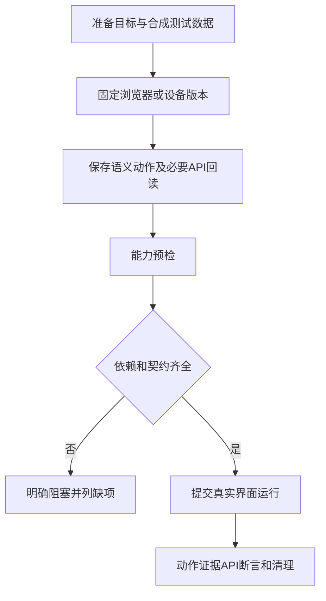

# Web与Android界面旅程

界面旅程执行真实页面或设备动作，不能用HTTP请求成功替代。

## 保存、能力预检、真实执行 {#flow}



扩展工具 → Web/App旅程与能力。web使用独立浏览器会话，不借用你的日常登录浏览器；android使用登记设备与Appium能力。缺驱动、指定构建或已确认契约时会阻塞，不制造成功。

## 最小动作JSON {#actions-example}

以下testid和接口路径为教学约定，要替换实际页面和契约：

```json
[
  {"step_id":"open","name":"打开客户页","action":"navigate","path":"/customers"},
  {"step_id":"check","name":"列表可见","action":"assert_visible","selector":{"strategy":"testid","value":"customer-list"}},
  {"step_id":"readback","name":"核对客户归属","action":"api_assert","operation_kind":"query","request":{"method":"GET","url":"{{host}}/api/customers/{{fixtures.item.id}}"},"assertions":[{"name":"同一对象","selector":"data.id","expected_ref":"fixtures.item.id"}]}
]
```

最后一个动作需要先声明并取得name=item的fixture，否则不能引用它；仅学习页面可见检查时先使用前两条并确认无写入。语义定位优先role、label、testid；角色可带name。可见按钮不等于业务提交成功，重要状态用已确认回读断言。

## 设备公开配置形状 {#device-example}

```json
{"name":"专用测试设备","device_secret_ref":"env:PYTA_SECRET_DEVICE","platform_version":"<实际Android版本>","app_package":"<实际包名>","app_activity":"<实际启动Activity>","app_build_sha256":"<实际SHA256>","installed_build_version":"<实际构建版本>","appium_url":"http://127.0.0.1:4723","media_capabilities":[]}
```

设备真实序列号由秘密引用提供；appium_url是执行器所在机器可访问的服务，不是当前浏览器用户电脑的任意地址。登记配置不证明设备在线或App流程通过。

## 旅程执行器 {#runner}

web执行独立浏览器动作，android执行登记的Android设备动作。

**在哪里使用：** 扩展工具 → Web/App旅程 → runner。

**填写或阅读示例：** 按被测端选web或android并补相应依赖。

**应该看到什么：** 能力预检列明缺少浏览器、设备或构建。

**常见错误：** HTTP通过后宣称真机已验证。

## Chromium 精确版本 {#browser-version}

固定运行器可用的完整浏览器版本以便复现，不是“最新版”。

**在哪里使用：** Web旅程 → Chromium精确版本。

**填写或阅读示例：** 刷新能力返回实际版本，按本次能力核对填写。

**应该看到什么：** 保存与执行按固定版本匹配。

**常见错误：** 猜浏览器版本，或填自己日常Chrome版本。

## 设备配置 / 版本 {#device}

指向已登记的不可变设备配置，包括系统、App构建和能力。

**在哪里使用：** Android旅程 → 设备配置ID/版本及公开JSON。

**填写或阅读示例：** 按本篇形状登记后填写返回真实ID和版本。

**应该看到什么：** 预检核对对应设备和App，不暴露序列号。

**常见错误：** 只填显示名，或登记后就以为在线通过。

## 测试数据来源确认 {#synthetic}

确认数据来源，勾选不会自动脱敏。

**在哪里使用：** 旅程 → 仅合成/已核验脱敏数据。

**填写或阅读示例：** 使用合成客户和受控媒体，核实后确认。

**应该看到什么：** 来源条件明确，录制仍受独立限制。

**常见错误：** 原始客户内容勾true就当脱敏。

## 浏览器 trace / 录屏 {#recording}

可能含页面网络内容，目前只允许合成数据且无凭证身份的Web场景。

**在哪里使用：** Web旅程 → 原生trace/录屏。

**填写或阅读示例：** 符合限制时显式开启capture_trace或capture_video。

**应该看到什么：** 生成可追踪采集附件，不补足业务验证缺口。

**常见错误：** 带登录身份或真实客户内容仍开启，或将录屏当自动脱敏。

## 旅程动作 JSON {#journey-actions}

按顺序定义语义动作或显式api_assert回读，动作带稳定step_id。

**在哪里使用：** 旅程 → 动作JSON。

**填写或阅读示例：** 使用本篇navigate/assert_visible，真实页面testid替换。

**应该看到什么：** 动作证据可追溯到步骤，回读按断言判断。

**常见错误：** 任意XPath/坐标或未声明fixture引用，按钮可见就当业务成功。

## 旅程能力预检 {#journey-preflight}

核对浏览器设备资源和契约前提，不跑完整业务旅程。

**在哪里使用：** 固定旅程版本 → 能力预检。

**填写或阅读示例：** 保存版本后预检，先处理缺驱动/构建等项。

**应该看到什么：** 知道能力是否具备，仍需真实提交。

**常见错误：** 预检通过就宣称W/A业务风险全通过。

## 提交界面旅程 {#journey-run}

实际执行Web/Android动作，可能改测试业务数据。

**在哪里使用：** 固定旅程版本 → 提交。

**填写或阅读示例：** 确认资源和构建后提交，到结果页查看终态。

**应该看到什么：** 受理run后产生真实动作和证据。

**常见错误：** 将受理当通过，或缺能力时删除约束硬跑。
