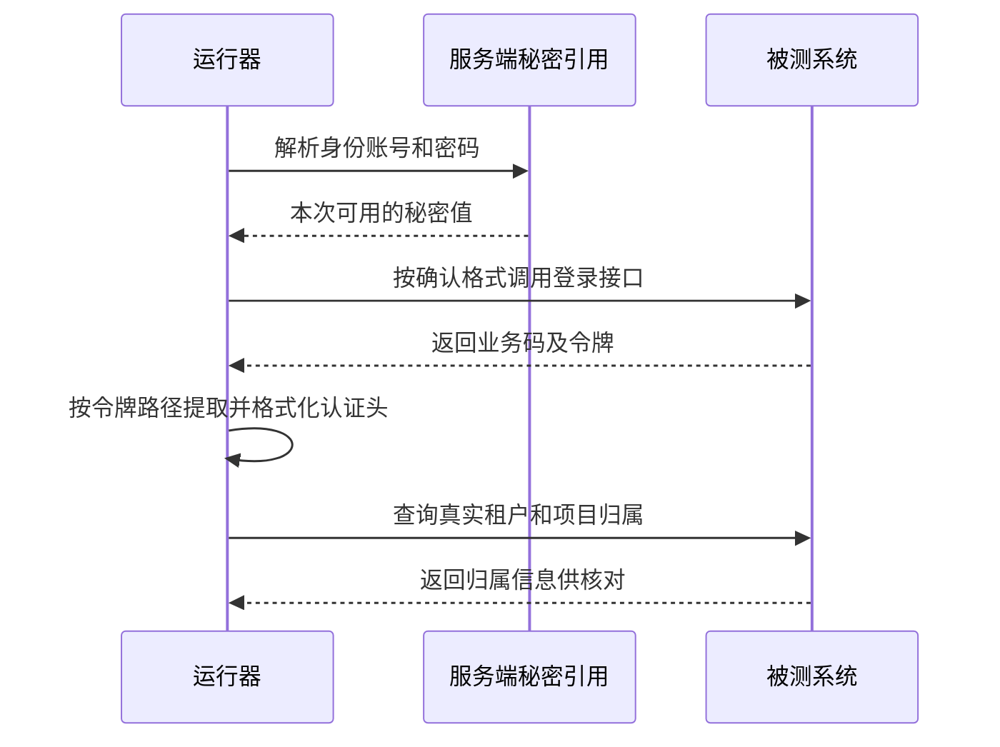

# 登录协议与令牌解析

登录不是只填一个地址，还需要请求格式、字段、密码处理和响应解析一致。

## 登录链路 {#flow}



请先向接口负责人确认登录请求和真实响应。以下 `data.token`、JSON 格式等只是常见例子，不是所有系统的默认协议。

## 按一份示例响应配置 {#example}

假设接口返回 `{"code":200,"data":{"token":"<本次令牌>"}}`，令牌字段路径填 `data.token`。若返回是 `{"access_token":"..."}`，就应填 `access_token`。密码转换和认证头前缀也要根据真实协议，不靠“登录失败后逐个试”判断。

## 登录失败排查顺序 {#errors}

先查秘密是否可用 → 请求格式和字段是否一致 → 密码是否按协议处理 → 业务码是否通过 → Token 路径是否存在 → 原始/Bearer 是否重复。HTTP 200 但令牌字段缺失不等于认证成功。

## 认证方式 {#auth-mode}

按接口是否需要登录选择无认证或密码登录。保存策略不会立刻登录。

**在哪里使用：** 目标系统 → 认证方式。

**填写或阅读示例：** 公开只读健康接口选无认证；客户列表需要账号则选密码登录并补齐协议。

**应该看到什么：** 运行/真实预检依据该协议准备认证。

**常见错误：** 把无认证当成绕过服务端权限的方式。

## 登录路径 {#login-path}

填写本目标内实际登录接口的相对路径。它与基础地址组合，而不是另一个服务的完整域名。

**在哪里使用：** 目标系统 → 登录路径。

**填写或阅读示例：** `/api/login`；实际若为 `/auth/login` 要按契约替换。

**应该看到什么：** 真实登录请求指向已确认的目标接口。

**常见错误：** 复制页面登录网址，或漏掉网关路径前缀。

## 登录请求格式 {#request-mode}

JSON 使用 JSON 请求体，表单使用表单编码。字段看起来一样，编码不同也会被服务拒绝。

**在哪里使用：** 目标系统 → 请求格式。

**填写或阅读示例：** 接口声明 application/json 时选 JSON；声明表单时选 form。

**应该看到什么：** 服务端能按约定读取账号、密码等字段。

**常见错误：** 仅手工改 Content-Type，却未让请求格式和 body 保持一致。

## 密码转换 {#password-transform}

none 把秘密原值用于请求，md5 在发送前转换。是否转换由业务登录协议决定。

**在哪里使用：** 目标系统 → 密码转换。

**填写或阅读示例：** 服务端明确要求原密码 MD5 时，秘密保存原值，选 md5；无需转换则 none。

**应该看到什么：** 发送前只按指定方式转换一次。

**常见错误：** 把已经 MD5 的文本再次 MD5，或凭密码长度猜测处理方式。

## 令牌字段路径 {#token-path}

写登录响应里令牌的取值路线，而不是令牌文本。

**在哪里使用：** 目标系统 → 令牌字段路径。

**填写或阅读示例：** 响应 `{"data":{"token":"..."}}` 时填 `data.token`。

**应该看到什么：** 能从本次登录响应取到令牌；字段缺失时认证不能算通过。

**常见错误：** 把 `Bearer ey...` 粘进路径，或假设所有接口都叫 token。

## User-Agent {#user-agent}

这是请求的客户端标识，部分系统会按终端类型分流行为。

**在哪里使用：** 目标系统 → 终端 User-Agent（可选）。

**填写或阅读示例：** 仅在已确认协议要求时填写约定的测试客户端标识，否则留空。

**应该看到什么：** 请求使用约定标识；并不意味着真的完成了设备端操作。

**常见错误：** 随意模拟一个 App 标识后宣称 App 界面已测试。

## 令牌格式 {#header-template}

决定令牌前是否加入 Bearer。原始 Token 与 Bearer 是不同服务协议。

**在哪里使用：** 目标系统 → 令牌格式。

**填写或阅读示例：** 响应值仅为令牌且接口要求 Bearer 时选择 `Bearer {token}`。

**应该看到什么：** 认证头前缀与服务约定一致。

**常见错误：** 响应已包含 Bearer 时再次拼接，形成 Bearer Bearer。

## 高级公开配置 {#profile-advanced}

用于补充可视化表单未展开的公开登录字段、令牌过期和已确认检查策略。表单字段以当前表单为准。

**在哪里使用：** 目标/身份/绑定配置 → 高级公开配置。

**填写或阅读示例：** 已有协议返回过期时间时，按配置模型声明对应字段及单位；只填写模型支持的字段，不把秘密值写入。

**应该看到什么：** 保存仍保留公开策略，后续真实预检才能证明实际可用。

**常见错误：** 增加模型未支持的字段（会被拒绝）、把毫秒当秒或在 JSON 放真实 Token。

### 高级公开配置的完整形状 {#advanced-auth-example}

在目标的高级公开配置框，可按真实协议补充以下形状；这是对应上述教学登录响应的例子，字段值仍要对照实际契约。

```json
{
  "auth": {
    "username_field": "mobile",
    "password_field": "password",
    "success_code_path": "code",
    "success_code": 200,
    "expiry_path": "data.expiresIn",
    "expiry_format": "relative_seconds"
  }
}
```

username_field表示登录接口接收账号的字段名；password_field是密码字段名。success_code_path是业务码路径，success_code是成功码。expiry_path从登录响应读取有效期，relative_seconds表示相对当前的秒数；只有接口真的提供该字段且单位一致时才填写。未知字段会被模型拒绝，不会悄悄保存。

登录路径、请求格式、密码转换、Token路径、认证头格式等已有可视化表单的同名字段，由表单值覆盖高级JSON；不要在两处填冲突值。要改令牌路径，请改表单中的“令牌字段路径”。
