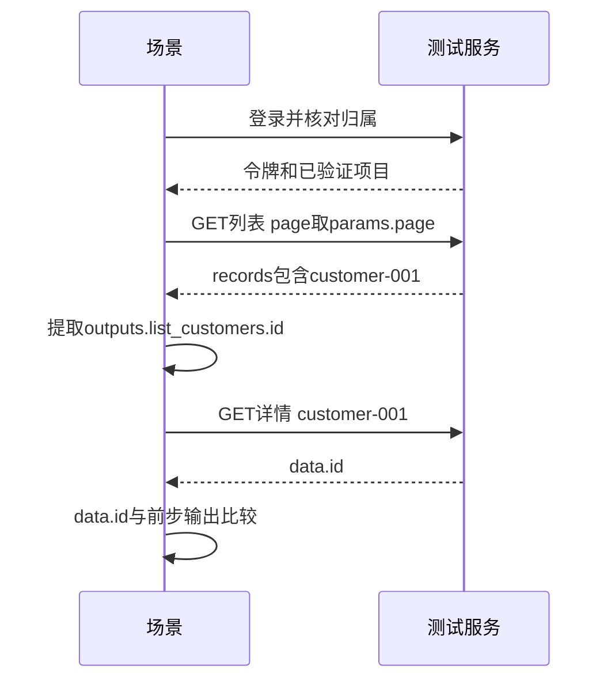

# 完整案例：登录后从列表查到详情

用同一组客户数据串起登录、项目、参数、提取、断言与固定版本回归。

## 本例业务故事与契约 {#story}

目标：在专用测试项目查询客户列表，再确认详情仍是同一个客户。本篇字段和地址为教学契约，不是某个现成接口；真实执行要替换为你已确认的测试服务。

准备接口：GET /api/customers 接收page并返回下方列表；GET /api/customers/{id} 返回详情。登录响应含data.token，归属响应含data.tenantId/data.deptId。先按真实契约准备专用账号、目标、绑定；如果实际协议不同，按[登录说明](/manual/login#example)修改。

```json
{"code":200,"data":{"records":[{"id":"customer-001","name":"测试客户"}],"total":1}}
```

## 第一步：配好执行上下文 {#context}

1. 创建测试环境与客户服务目标，基础地址为真实测试地址，配置真实登录路径、请求格式、密码转换、token_path和令牌头格式。
2. 由服务人员准备账号密码秘密，网页身份填写对应引用并选择可用目标。
3. 保存正确租户/项目绑定，归属查询路径和回读字段按真实响应配置。
4. 预检先看配置，再明确执行真实登录/查询，分别确认认证、归属和服务证据，not_run/not_verified不可当通过。

## 第二步：声明参数 {#parameters}

场景参数schema填 `{"page":{"type":"integer","required":true}}`，默认公开参数 `{"page":1}`。本次想查第二页时才填 `{"page":2}`；先保证该页确实有已确认测试样本。

## 第三步：列表步骤 {#list-step}

添加HTTP步骤list_customers，阶段verify，方法GET，URL `{{host}}/api/customers`，query的page=`{{params.page}}`，body_type=none，业务用途query，按实际契约确认。

断言响应体code equals数字200，data.records exists。再配置提取：

```json
[{"name":"客户ID","source":"response_body","selector":"data.records.0.id","target":"outputs.list_customers.id","required":true}]
```

真实列表不是固定合成数据时，应按明确筛选和对象归属锁定预期对象，不依赖任意第一条。空列表会使必需提取失败，这是前提缺少，不删掉提取来伪装成功。

## 第四步：详情与动态断言 {#detail-step}

第二个HTTP步骤get_customer，阶段verify，依赖 `list_customers`，GET `{{host}}/api/customers/{{outputs.list_customers.id}}`，none请求体、已确认query。

```json
[
  {"name":"业务码正确","source":"response_body","selector":"code","operator":"equals","expected":200},
  {"name":"同一客户","source":"response_body","selector":"data.id","operator":"equals","expected_ref":"outputs.list_customers.id"}
]
```

expected_ref直接写路径，不加双花括号；请求URL才使用模板。详情返回customer-002就应失败，不能把期望改成customer-002。



## 第五步：调试到正式回归 {#finish}

先调试当前整场景，核对实际请求和两步断言。单独调试详情时，需显式输入 `{"list_customers":{"id":"customer-001"}}`，不会自动跑列表；数据库核验等限制另见[单步](/manual/debugging#single-step)。

结果符合后保存 → 发布预检 → 写发布说明 → 发布v1 → 预览计划 → 填真实业务构建并确认运行 → 看结果终态和清理。加入“客户查询回归”套件时固定该场景v1，发布套件后再按[调度教程](/manual/scheduling#create)设定工作日09:00。

新字段修正后发布v2并显式更新套件，不靠编辑草稿改变已发布执行。某个失败场景复跑通过后，仍不要宣称整个批次已经重跑成功。
