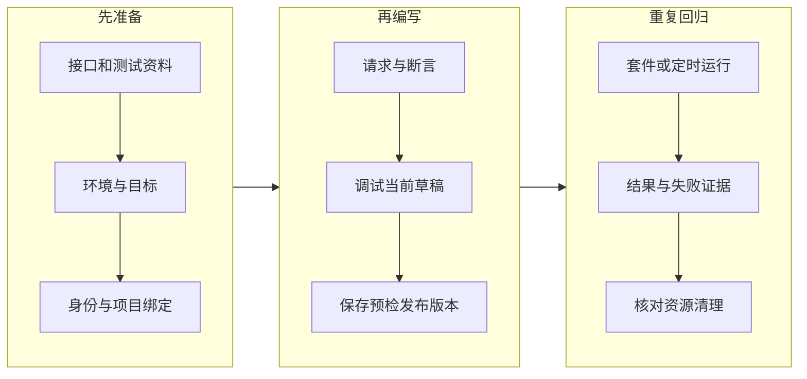

# 先看懂平台，再开始配置

把平台理解为一份能反复执行、保存证据的业务检查清单。

## 一张图看全流程 {#start}

你平时会先登录系统、选择项目、查一条记录，再确认返回是否正确。平台把这些动作写成“场景”，以后按同一套规则重复执行。

不需要登录的接口，可以不配置身份；不区分租户/项目的系统，可以不配置项目绑定。是否需要取决于被测系统的真实接口要求，不能为了少填两项把必要配置关掉。

## 场景、步骤、套件分别是什么 {#concepts}

| 名词 | 用业务语言解释 | 本手册例子 |
| --- | --- | --- |
| 步骤 | 一次具体动作及其检查 | 查询客户列表 |
| 场景 | 完成一个目标的一组步骤 | 查列表，再用查到的 ID 查详情 |
| 用例 | 平台中的测试检查资产；详细编排以场景和步骤承载 | 客户查询正确性 |
| 套件 | 一批固定版本场景的组合 | 每日客户查询回归 |
| 断言 | 明确写下“什么结果才算正确” | code 应为数字 200 |
| 运行 | 把已确定的内容实际执行一次 | 今天 09:00 的回归记录 |

“发布版本”是冻结测试定义供回归引用，不是发布业务应用。“提交运行成功”是任务受理，不等于测试通过。

## 你应该按什么顺序读 {#reading-order}

1. 从[准备资料](/manual/prepare#checklist)确认手头有真实地址和接口契约。
2. 不熟接口时先读 [HTTP](/manual/http#request-response) 和 [JSON](/manual/json#types)。
3. 跟随[第一条查询](/manual/first-query#steps)走一次最短操作路径。
4. 需要登录和传递 ID，再读[多步完整案例](/manual/multi-step#story)。
5. 遇到陌生字段，从原页面问号打开对应小节；手册在新标签页阅读，原页内容保留。
