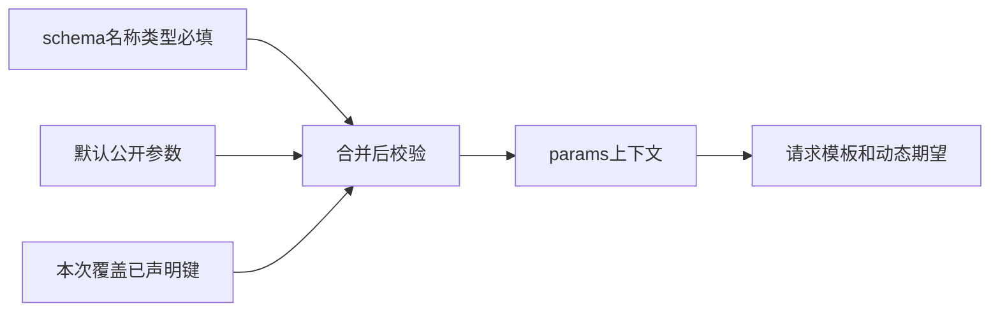

# 公开参数：默认值与本次覆盖

把会变化的公开业务值从请求里提出来，复用同一场景。

## 一组填写示例 {#example}

参数schema：

```json
{"page":{"type":"integer","required":true},"customer_id":{"type":"string","required":false}}
```

默认公开参数：

```json
{"page":1,"customer_id":"customer-001"}
```

query的page值可填 `{{params.page}}`。不是账号密码；秘密用身份引用。

## 三份东西的关系 {#precedence}



先复制默认参数，再用本次参数覆盖同名键。**本次每一个覆盖键必须在parameters_schema声明**；默认JSON有该键也不代表可随意覆盖。合并后检查必填与类型，数字不接受布尔值。

套件参数按场景ID分组，如 `{"scenario-customer":{"page":2}}`；单场景则直接 `{"page":2}`。外层场景ID要替换为真实值。

## 参数 schema {#schema}

参数规则表，不是参数值。声明type/required，为本次覆盖确定范围。

**在哪里使用：** 场景设置 → 场景参数 → 参数schema。

**填写或阅读示例：** `{"page":{"type":"integer","required":true}}`，默认另填 `{"page":1}`。

**应该看到什么：** page=2通过，page="2"类型不符。

**常见错误：** 把值JSON当schema，或覆盖未声明键。

## 公开参数 JSON {#parameters}

公开业务输入供params引用，默认复制后再按入口格式覆盖。

**在哪里使用：** 默认参数/本次运行或调试参数/计划参数。

**填写或阅读示例：** schema有page时本次填 `{"page":2}`，query用 `{{params.page}}`。

**应该看到什么：** 本次用2，默认1不会自动保存成2。

**常见错误：** 混淆套件分组格式，或放进密码。
