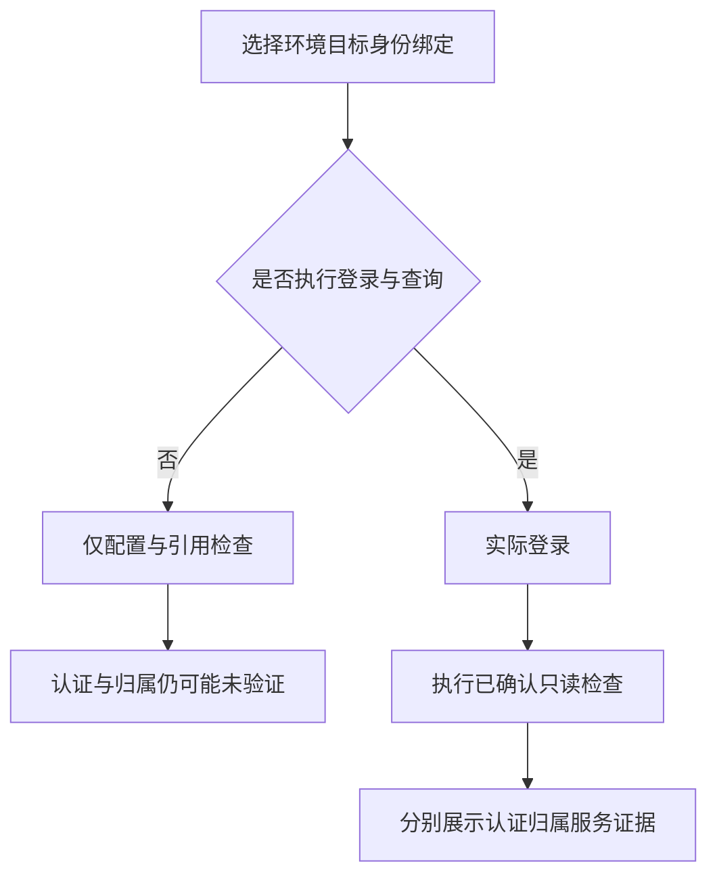

# 预检：哪些检查真的发请求

读懂配置、认证、归属、服务四栏，才知道目前验证到了哪一步。

## 两种模式 {#modes}

环境与身份预检和“发布预检”不是同一个按钮。发布预检主要检查已保存场景结构和引用；此处可选择真正登录并执行确认查询。不要把一种预检的通过套用到所有范围。

## 四栏结果怎么解释 {#states}

| 结果栏 | 回答的问题 | 不足时怎么做 |
| --- | --- | --- |
| configuration | 公开配置/引用是否成立 | 核对地址、ID、秘密名称 |
| authentication | 实际登录是否验证 | 检查登录协议和秘密 |
| context | 是否回读到要求的租户项目 | 检查归属查询与返回路径 |
| service | 已确认查询是否可用 | 检查接口契约和返回 |

`not_run` 表示本次未执行认证/归属/服务请求，常见于未勾选真实登录的配置检查；`not_verified` 是没有足够证据，不是默认通过；`not_required` 表示本契约不要求该项，不能当作验证过的权限。

## 执行登录与查询预检 {#execute-login}

不选时只检查配置，选中才实际登录并执行已经确认的只读检查。

**在哪里使用：** 环境管理 → 登录与项目预检 → 执行已确认登录与查询。

**填写或阅读示例：** 先不选排除结构问题，再在已确认测试范围内选中做真实预检。

**应该看到什么：** 结果各栏显示对应验证程度，真实请求仅发生在明确选择执行时。

**常见错误：** 把“预检”一律理解为绝不发请求，或勾选后认为任意接口都得到验证。

## 环境与身份预检 {#context-preflight}

检查这次选定的环境、目标、身份、绑定是否一致；结果只对应本组合。

**在哪里使用：** 环境管理 → 登录与项目预检 → 预检。

**填写或阅读示例：** 选择目标 customer-test 及匹配身份/绑定后预检，并分别看四栏状态。

**应该看到什么：** 清楚知道是配置通过、认证通过还是上下文仍未验证。

**常见错误：** 切换目标或项目后沿用旧结果，或仅凭总提示 code=200 判断全部通过。
