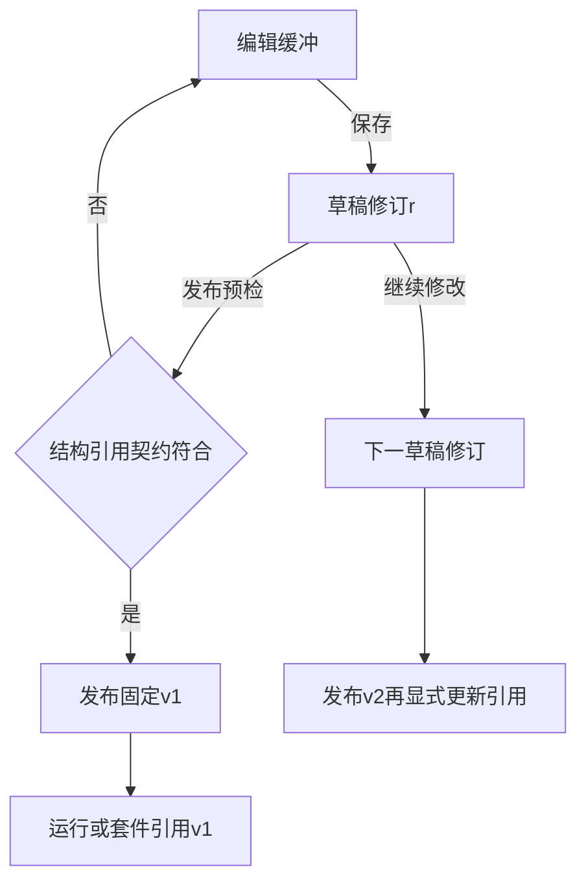

# 保存、预检、发布是三个动作

> 当前界面入口：在用例或套件工作区选择“发布与版本”，直接完成发布预检、填写发布说明和发布；同一区域查看版本历史。无需滚过全部步骤。预检失败时先修复对应步骤或设置，再保存重试。

先保存编辑，再检查定义，最后冻结供正式回归引用。

## 版本生命周期 {#lifecycle}

编辑草稿不会改写v1；发布测试资产不等于部署业务应用。要用新测试内容，先发布新版本，再更新套件引用，必要时再发布套件并更新调度。

## 发布预检 {#preflight}

检查已保存结构、引用和契约，不发业务请求。

**在哪里使用：** 已保存资产 → 发布预检。

**填写或阅读示例：** 保存后预检，按steps.1.depends_on等错误路径修正。

**应该看到什么：** valid=true仅说明定义满足结构规则。

**常见错误：** 未保存就期待检查编辑缓冲，或与真实登录预检混淆。

## 发布不可变版本 {#publish}

冻结已保存且满足条件的定义。

**在哪里使用：** 发布说明 → 发布不可变版本。

**填写或阅读示例：** 说明“增加详情ID断言”，保存预检后发布v2。

**应该看到什么：** 旧v1保留，新运行可选v2。

**常见错误：** 认为自动部署或立即执行，忽略未保存修改。

## 固定发布版本 {#version}

已发布的存在版本，供结果复现，非草稿修订号。

**在哪里使用：** 运行/套件引用 → 固定发布版本。

**填写或阅读示例：** 选v2，计划显示该version及hash。

**应该看到什么：** 草稿后续变化不改变本次固定内容。

**常见错误：** 输入r号当v号，或指望自动跟随latest。

## 归档草稿 {#archive}

移出常规可编辑目录，不是取消执行或抹除发布历史。

**在哪里使用：** 资产编辑 → 归档草稿。

**填写或阅读示例：** 确认无需继续编辑后归档，先核对相关用途。

**应该看到什么：** 不再按普通草稿提供编辑入口。

**常见错误：** 用归档停止正在运行任务。
