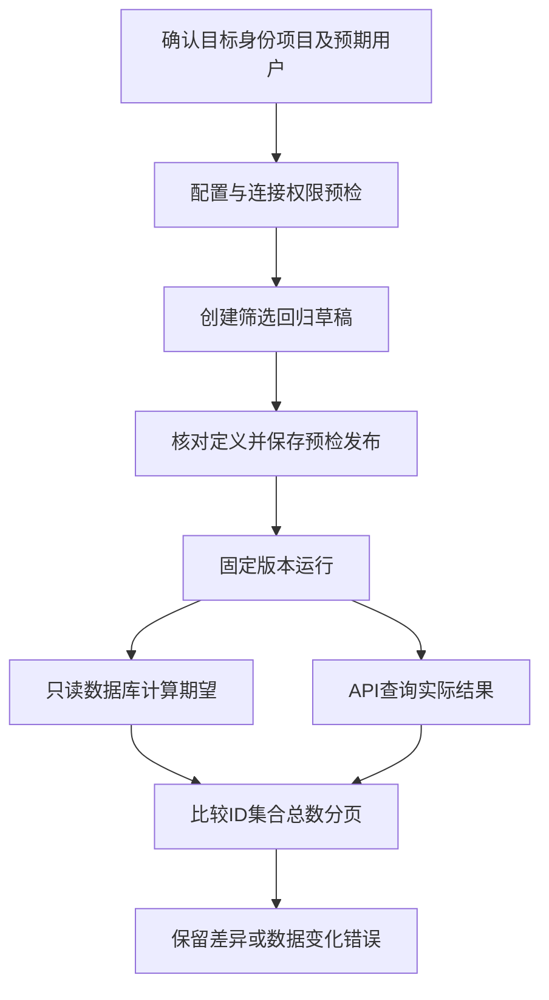

# 言迹查询包与接诊筛选回归

用实际API结果对照独立测试库事实，发现漏查、多查、错误总数与分页问题。

## 从配置到独立期望 {#flow}

不能把API自己返回的total当独立标准再去证明自己。数据库提供另一条事实来源；请求前后事实变化会明确报数据变化，不强行放绿。

## 页面操作 {#steps}

1. 环境管理准备言迹测试目标、专用测试身份和项目绑定，真实回读用户及项目。
2. 用例管理展开“接入言迹测试环境查询包”，填预期测试用户ID，再展开“接诊记录筛选回归”。
3. 选业务数据源，先检查配置，再明确验证连接与权限。
4. 创建回归草稿；此时只保存定义，不自动发布/执行，重复导入保留已有编辑。
5. 检查请求、字段及数据库核验说明，保存预检并发布；加入套件时固定版本。
6. 预览计划、填真实构建、确认范围运行，到结果页查差异。

数据库核验步骤必须使用整场景调试以先核对身份和项目，不能用手填outputs代替该前置安全条件。

## 目前覆盖和限制 {#limits}

覆盖默认查询、状态、客户类型、日期、接待人、组合、接诊ID关键词、空关键词、无录音、短录音及完整分页。当前只支持确认的项目超管身份，不代表普通员工权限回归已完成。

非空分支缺样本会报覆盖缺口，不能当空结果成功；超出行数/分页上限明确失败，不截断后比较。相同创建时间允许组内顺序变化，但完整分页仍检查重复/遗漏；数据库和HTTP不是原子事务，可检测观察到的变化，不能保证识别两次采样间变化又恢复的情况。

## 接诊筛选回归 {#reception-pack}

生成受控筛选回归草稿，数据库计算独立期望，查ID/total/去重/分页。

**在哪里使用：** 用例 → 接诊记录筛选回归。

**填写或阅读示例：** 准备目标、身份、绑定、预期用户和来源，验证后创建。

**应该看到什么：** 得到可审查草稿，发布运行沿用通用流程。

**常见错误：** 创建即宣称回归通过，或缺样本仍声称覆盖。

## 预期测试用户 ID {#expected-user}

业务系统内此测试身份真实用户ID，用于回读确认登录的是谁。

**在哪里使用：** 查询包或Web smoke → 预期测试用户ID。

**填写或阅读示例：** 填专用测试用户真实ID，不是账号手机号或显示名。

**应该看到什么：** 回读结果必须与预期一致。

**常见错误：** 复制其他账号ID，或填示例synthetic-user后期待真实通过。

## 言迹查询包 {#yanji-pack}

现有言迹身份、菜单、接诊及人设查询模板入口；Web版本还需浏览器。

**在哪里使用：** 用例查询包/扩展工具Web查询smoke。

**填写或阅读示例：** 选匹配测试目标身份绑定及用户ID，创建查询草稿或旅程。

**应该看到什么：** 只生成定义，不能等同写入回归或完整W/A风险验收。

**常见错误：** 把查询smoke成功当所有业务和App已验证。
