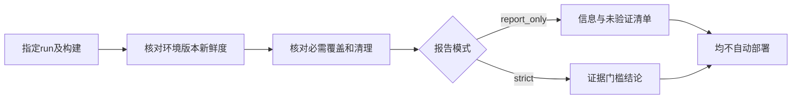

# 发布回归摘要与证据范围

汇总某个构建的选定运行，不自动批准部署。

## 先选证据，再生成报告 {#scope}

在调度任务展开“生成发布回归摘要”，填写本次实际run ID、被测构建及模式。只有选定范围的真实、新鲜、版本匹配证据才有相应意义；旧环境成功不替代新环境失败。

局部复跑通过仅说明失败部分重新验证，不能冒充完整套件。报告仍需明确选择范围并检查缺口。

## 发布报告运行范围 {#report-runs}

参与本报告的实际运行ID，不自动包含所有历史。

**在哪里使用：** 发布摘要 → run IDs。

**填写或阅读示例：** `run-a,run-b`，替换实际同构建run ID。

**应该看到什么：** 摘要可追溯每条证据及排除项。

**常见错误：** 填写套件ID、场景ID，或混入不同环境成功凑通过。

## 发布报告模式 {#report-mode}

report_only只汇总，strict额外检查真实新鲜证据、必需覆盖和清理。

**在哪里使用：** 发布摘要 → 模式。

**填写或阅读示例：** 先report_only查缺口，满足契约再看strict。

**应该看到什么：** 缺证据明确列出/阻断，不自动部署。

**常见错误：** 认为strict等于业务发布授权。

## 发布回归摘要 {#report}

汇总本构建的结果和未知项，结论限于选定证据。

**在哪里使用：** 调度 → 生成发布回归摘要。

**填写或阅读示例：** 选run、填真实build、选模式生成。

**应该看到什么：** 看到成功/失败/未验证项和覆盖状态。

**常见错误：** 把单run完整性当所有风险都覆盖。
