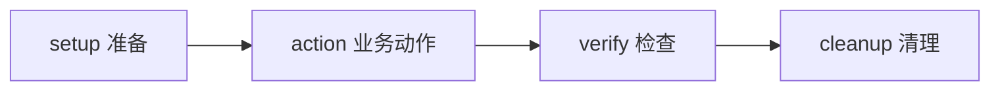

# 场景与步骤：把业务检查拆清楚

先确定业务检查目标，再为每次请求命名和安排阶段。

## 从目标拆成步骤 {#split}

“列表里的客户点开后仍是同一个人”可拆成：查询列表 → 保存已确认测试对象ID → 查询详情 → 断言详情ID一致。新建时先在场景设置填写名称、目标和身份；选择已保存场景后，默认进入“编辑与调试”。左侧选择步骤，中间只显示当前步骤；场景名称、目标和身份在“场景设置”标签页。切换步骤保留当前未保存输入。

## 阶段与依赖 {#phase-order}

只读场景可以只有verify。阶段应按上图顺序前进；读取前置输出还必须明确声明依赖，不能只靠步骤在屏幕上的位置。

## 优先级 {#priority}

表达业务重要程度，不自动改变执行顺序或调度频率。

**在哪里使用：** 场景/套件设置 → 优先级。

**填写或阅读示例：** 登录主路径P0，主要查询P1，补充边界P2。

**应该看到什么：** 目录便于整理，执行仍按计划和依赖。

**常见错误：** 认为P0会自动优先调度。

## 标签 {#tags}

公开业务分类标记，便于搜索，不是运行参数。

**在哪里使用：** 场景/套件设置 → 标签。

**填写或阅读示例：** `customer,smoke,query`，英文逗号分隔。

**应该看到什么：** 可按业务关键词找到资产。

**常见错误：** 用中文逗号形成一个长标签，或放入密码。

## 稳定步骤 ID {#step-id}

机器长期引用的标识，必须唯一，以字母或下划线开头，后续可用字母数字下划线或连字符。

**在哪里使用：** 步骤 → 稳定 ID。

**填写或阅读示例：** `list_customers`；输出使用 `outputs.list_customers.id`。

**应该看到什么：** 依赖和输出引用稳定，中文名称可独立改。

**常见错误：** 复制后重复ID，或改ID却未更新依赖/提取目标。

## 步骤类型 {#step-type}

HTTP发一次请求；等待异步终态会重复执行已确认无副作用查询。

**在哪里使用：** 步骤 → 类型。

**填写或阅读示例：** 列表查询选HTTP，后台任务的状态查询选wait_until。

**应该看到什么：** 显示该类型对应字段，发布时核对。

**常见错误：** 把反复提交写请求当等待。

## 执行阶段 {#phase}

组织准备、动作、验证和清理；阶段顺序和显式依赖配合。

**在哪里使用：** 步骤 → 阶段。

**填写或阅读示例：** 列表和详情都可为verify，准备资源为setup。

**应该看到什么：** 预检不会出现阶段回退错误。

**常见错误：** verify之后再添加setup，或只改名称期待改变阶段。

## 草稿与启用状态 {#asset-status}

草稿可编辑，发布版本被冻结。启用/已保存不是业务验证通过。

**在哪里使用：** 用例目录 → 状态；编辑顶部。

**填写或阅读示例：** 编辑后未保存，保存后r增加，发布得到v1。

**应该看到什么：** 清楚正在看编辑缓冲还是固定版本。

**常见错误：** 把已保存或启用当执行成功。

## 配置修订号 {#configuration-revision}

修订号用于并发编辑，v/version是发布快照。

**在哪里使用：** 资产/公开配置/计划的r或revision。

**填写或阅读示例：** 草稿r3保存后r4，发布后可能v2，旧v1保留。

**应该看到什么：** 旧修订保存会拒绝而不是覆盖。

**常见错误：** 把r4填进固定发布版本v4。
