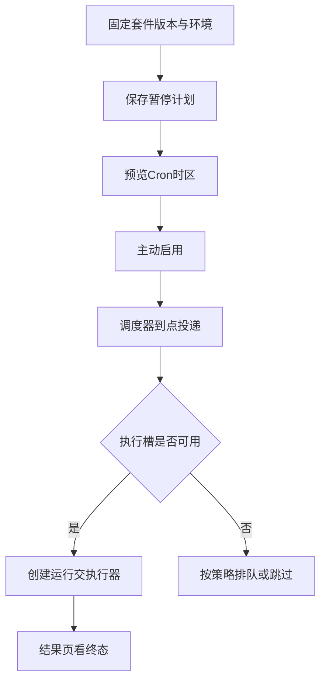

# 调度：按时间重复执行回归

> 当前界面入口：调度页左侧搜索并选择计划，右侧“计划配置”编辑套件、版本、环境和时间规则，“触发与记录”查看时间预览、触发历史及启停操作。“调度运维与摘要”提供全局状态、暂停新触发和回归摘要，注意与单个计划操作区分。

固定套件和环境，预览时间，再启用自动真实运行。

## 创建计划的顺序 {#create}

调度任务 → 新建 → 选择已发布套件/版本/环境 → 时间规则和预算 → 保存为暂停 → 预览五次 → 核对 → 启用。不要第一次保存后就以为马上自动跑。

调度器负责到点投递，执行器负责测试。计划已启用但执行器不可用时不会凭空执行成功。暂停、删除、暂停全部都不撤销已受理运行。

## Cron与时区先看预览 {#time-example}

`0 9 * * 1-5`表示周一至周五09:00；时区填Asia/Shanghai。五段依次为分钟、小时、日、月、星期；0或7为周日。使用常用时间规则可让页面生成Cron，复杂规则再选高级。

## 标准 5 段 cron {#cron}

标准五段规则，不包含秒。

**在哪里使用：** 调度 → 高级Cron。

**填写或阅读示例：** `0 9 * * 1-5`，核对五次预览。

**应该看到什么：** 工作日按所选时区09:00触发。

**常见错误：** 粘六段Quartz表达式或误认星期0为周一。

## IANA 时区 {#timezone}

Cron按此标准地区时区解释。

**在哪里使用：** 调度 → IANA时区。

**填写或阅读示例：** `Asia/Shanghai`，非“北京时间”文字。

**应该看到什么：** 预览时间带正确偏移。

**常见错误：** 混用UTC和本地时间，忽略夏令时。

## 错过触发策略 {#missed}

停机错过触发时skip跳过；fire_once合并补一次，不补跑全部。

**在哪里使用：** 调度 → 错过策略。

**填写或阅读示例：** 不允许补发写测试时skip；确认可补时fire_once。

**应该看到什么：** 恢复后按该策略处理错过时间点。

**常见错误：** 以为fire_once会逐条重放所有历史计划。

## 执行槽忙策略 {#busy-policy}

queue在预算内排队，skip跳过这次触发。

**在哪里使用：** 调度 → 执行槽忙。

**填写或阅读示例：** 查询回归允许等待选queue，高频无积压要求选skip。

**应该看到什么：** 繁忙时行为明确而不是无限堆积。

**常见错误：** 以为queue保证一定执行，不考虑到期。

## 排队预算 {#queue-budget}

等待领取的时长上限，和开始后的执行预算不同。

**在哪里使用：** 调度 → 排队预算秒。

**填写或阅读示例：** 排队300秒，执行预算另设。

**应该看到什么：** 未开始即过期则超时，不发这次业务请求。

**常见错误：** 把排队时间算成每步HTTP超时。

## 发布套件 ID {#suite-id}

真实套件资产ID及存在的固定版本。

**在哪里使用：** 调度 → 发布套件。

**填写或阅读示例：** 从目录选“客户查询回归”v1。

**应该看到什么：** 计划绑定可复现版本。

**常见错误：** 用显示名称代ID，或未发布就启用。

## 保存为暂停计划 {#schedule-save}

保存定义但不自动触发，给你核对时间和范围机会。

**在哪里使用：** 调度 → 保存为暂停计划。

**填写或阅读示例：** 填完保存，列表显示paused，再预览。

**应该看到什么：** 没有因为保存立即创建业务运行。

**常见错误：** 等待它自动开始而未主动启用。

## 启用 / 暂停计划 {#schedule-toggle}

active按时创建真实运行，paused只停后续触发。

**在哪里使用：** 计划列表 → 启用/暂停。

**填写或阅读示例：** 确认范围后启用，维护前暂停。

**应该看到什么：** 已创建run仍需在结果页单独取消。

**常见错误：** 暂停后以为正在执行请求已撤回。

## 暂停全部新触发 {#pause-all}

全局暂停后续投递，不是逐个终止现有任务。

**在哪里使用：** 调度器状态 → 暂停全部新触发。

**填写或阅读示例：** 维护前先暂停全部，再检查活动run。

**应该看到什么：** 所有计划未来触发暂停，已有任务仍可见。

**常见错误：** 以为只影响当前选中计划。

## 删除计划 {#schedule-delete}

移除该定义，停止由它产生未来触发。

**在哪里使用：** 计划列表 → 删除计划。

**填写或阅读示例：** 不再使用的计划核对后删除。

**应该看到什么：** 关联历史运行保留，活动run不自动取消。

**常见错误：** 拿删除当强制取消按钮。

## 预览五次触发 {#schedule-preview}

只计算未来五次时间，不创建运行。

**在哪里使用：** 计划列表 → 预览5次。

**填写或阅读示例：** 核对周一至周五09:00及+08:00。

**应该看到什么：** 显示带时区时间列表。

**常见错误：** 预览符合就认为真实执行器和接口也已通过。

## 触发记录 {#triggers}

记录每个planned_at的投递、错过、跳过及关联run。

**在哪里使用：** 计划列表 → 触发记录。

**填写或阅读示例：** 找到某天09:00，沿run ID查看结果。

**应该看到什么：** 区分调度投递成功与业务断言结果。

**常见错误：** 触发成功直接报业务通过。

## 调度与执行器状态 {#scheduler}

查看心跳、队列及执行器可用信息。

**在哪里使用：** 调度与执行器状态 → 查看状态。

**填写或阅读示例：** 计划未运行时先看scheduler和worker状态。

**应该看到什么：** 判断是在等时间、排队还是执行器不可用。

**常见错误：** 只看计划active就认定系统正在执行。

## 计划状态与执行模式 {#schedule-state}

active启用，paused暂停；live真实请求。historical_unknown为旧模式不明确。

**在哪里使用：** 计划列表 → 状态与模式。

**填写或阅读示例：** 新计划先paused/live，预览后active。

**应该看到什么：** 历史需要迁移时明确阻止误启用。

**常见错误：** 把paused当取消全部run，或忽视历史模式未知。
